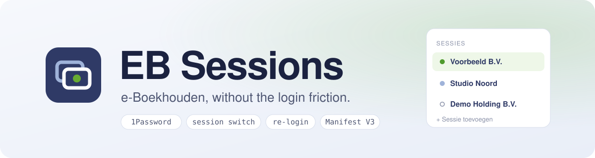
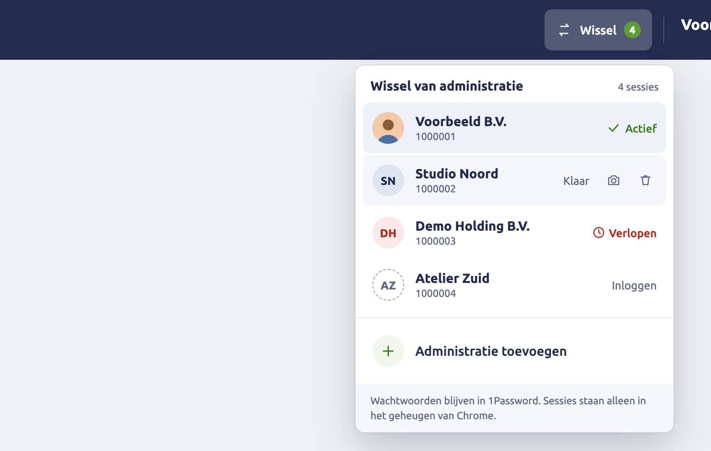
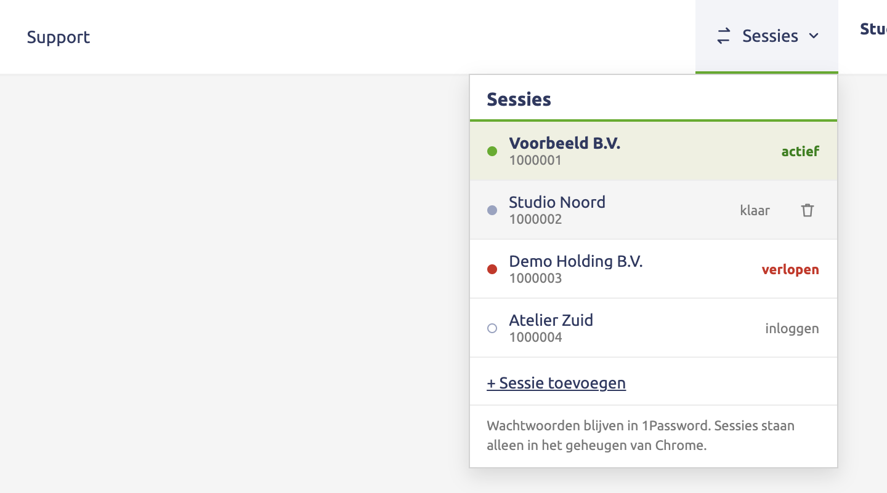
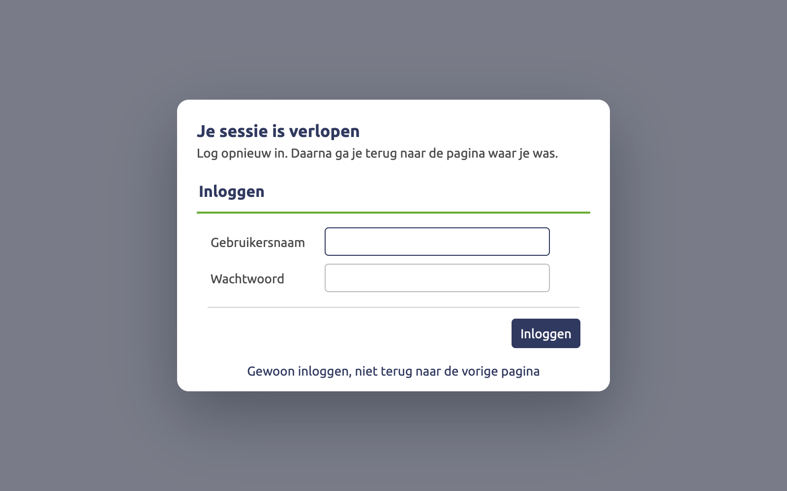

<div align="center">

<picture>
  <source media="(prefers-color-scheme: dark)" srcset="assets/banner-dark.svg">
  
</picture>

<br>

<a href="https://github.com/SherinBloemendaal/eboekhouden-extension/actions/workflows/ci.yml"></a>
<a href="LICENSE"></a>


**EB Sessions** is a small Chrome extension for [e-Boekhouden.nl](https://www.e-boekhouden.nl) that makes 1Password autofill work on the login page, switches between administrations in one click, and turns an expired session into a login dialog instead of a lost page.<br>
Repo: [github.com/SherinBloemendaal/eboekhouden-extension](https://github.com/SherinBloemendaal/eboekhouden-extension)

[Install](#-install) · [Highlights](#-highlights) · [1Password](#-1password-on-the-login-page) · [Switching](#-switching-sessions) · [Login page](#-login-page) · [Importing](#-importing) · [Better design](#-better-design) · [Pop-ups](#-pop-ups-als-venster) · [Re-login](#%EF%B8%8F-re-login-dialog) · [Security](#-security) · [Development](#-development)

</div>

<br>

> [!NOTE]
> This is an unofficial, personal tool. It is not made by or affiliated with e-Boekhouden.nl. It only changes how pages are shown in your own browser, and it never submits forms or bookings for you.

## ✨ Highlights

- **One click between administrations.** A switcher in the e-Boekhouden header lists every administration you logged in to in this Chrome session. Pick one and all e-Boekhouden tabs move over, no logging out and in.
- **1Password works on the login page.** The login form moves out of e-Boekhouden's old frameset into a normal iframe, where 1Password's inline menu stays open.
- **Expired session? Log in where you are.** Instead of being dropped on the login page, you get a dialog over the page, with 1Password working there too. After login you are back on the page you were on.
- **A faster import screen.** Shift-click selects a range of bank lines, and an action bar keeps *Wegboeken* and *Verwijderen* in view while lines are selected.
- **Better design, if you want it.** One switch in the popup turns on a redesigned login page and import screen: search, filters, groups, hiding lines, and the mutation screen in a dialog.
- **Passwords never touch the extension.** Logging in always goes through the real e-Boekhouden form and 1Password. The extension stores session cookies in memory only, and only for e-Boekhouden.
- **No dependencies, no network calls.** Plain JavaScript, no build step, nothing sent anywhere.

## 📦 Install

The extension is not on the Chrome Web Store. Load it unpacked:

```bash
git clone https://github.com/SherinBloemendaal/eboekhouden-extension.git
```

1. Open `chrome://extensions` in Chrome.
2. Turn on **Developer mode** (top right).
3. Click **Load unpacked** and choose the `eboekhouden-extension` folder.
4. Reload any open e-Boekhouden tab.

To update, run `git pull` in the folder and click the reload icon on the extension's card in `chrome://extensions`. Then reload the open e-Boekhouden tabs: the copy of the extension that was running in them stops working after a reload. To remove it, click **Remove** on that card; that also deletes everything it stored.

## 🔑 1Password on the login page

On e-Boekhouden's own login page, 1Password's inline menu closes the moment it opens. The page is a legacy HTML4 `<frameset>`, and 1Password's inline menu does not survive in one: it opens and is removed about 40 ms later. In a normal page with an `<iframe>` it works.

The fix comes from DacTecTools by Dion, which solved the same problem first:

- **Swap the frameset for an iframe.** On the login screen the extension keeps the address `/bh/` and replaces the `<frameset>` with a `<body>` holding one same-origin `<iframe name="mainframe">` that loads `/bh/inloggen.asp`. The form stays nested, so the page's own `if (top === window)` guard does not send it back to `/bh/`.
- **Back into the app after login.** Once the iframe leaves the login page, the tab opens the app the way e-Boekhouden itself does (`/bh?v2Url=…`), and the re-login dialog's return to your previous page still applies. "U bent reeds ingelogd" (opening `/bh/` while still logged in) goes straight to the app as well.
- **Fields password managers understand.** The username and password fields get `autocomplete`, `name` and `id`, sit in a real `<form>`, and a filled-in value fires `input` and `change` events, so Angular forms on secure20 pick it up too.

Checked in Chrome with 1Password: before the swap the menu was removed about 40 ms after opening; with it, the menu stays open.

## 🔀 Switching sessions

Cookies in Chrome are shared by every tab of a profile, so two administrations cannot be logged in side by side in one profile. The switcher does the next best thing: it keeps a copy of each administration's e-Boekhouden cookies and swaps them in when you switch.

The switcher is a navbar item in e-Boekhouden's own header, styled after whichever design you use. It is placed while the header renders, so it is there from the first frame.

<table>
<tr>
<td width="50%" valign="top"><b>New design</b><br><br></td>
<td width="50%" valign="top"><b>Legacy design</b><br><br></td>
</tr>
</table>

- **Logging in adds the administration.** The frameset's title is the administration's name, so after each login the session is saved under that name, with the number from the header.
- **Pick one to switch.** The current cookies are saved, the chosen ones are put back, and every e-Boekhouden tab opens the app the way e-Boekhouden itself does after login (`/bh?v2Url=…`). With more than one e-Boekhouden tab open, the switcher asks first, because unsaved input in those tabs is lost.
- **Administratie toevoegen** (*Sessie toevoegen* in the legacy design) saves the current session and opens an empty login screen for the next administration.
- **Status per entry:** *Actief* (the one you are in), *Klaar* (ready to switch to), *Verlopen* in red (e-Boekhouden ended that session; picking it opens the login screen), *Inloggen* (known, but no session in memory).
- **Profile pictures** (new design only). Hover an entry and click the camera to pick a picture. It replaces the initials circle in the e-Boekhouden header while that administration is active, and shows in the list. Pictures are cropped to 128 px and stored locally; they are never uploaded.
- **Remove an entry** with the bin icon on hover. Logging out does not remove it: the entry keeps its name, number and picture and shows *Inloggen*.
- **Matching after a new login.** The session lands on its old entry by the username typed at login plus the administration number from the header, then by the number alone, then by the name. That keeps the picture when an administration is renamed, and keeps two administrations of one user apart.
- **The toolbar popup** shows the same list with *Wissel*, *Inloggen* and *Opnieuw inloggen* buttons, a camera per entry, and the settings.

Sessions live in memory, so after restarting Chrome each administration asks for one login again. Names, numbers and pictures stay.

## 🚪 Login page

The login page shows what is still open. *Actieve sessies* lists the administrations whose session is still saved; one click opens it, without logging in. *Eerder gebruikt* lists the expired and logged-out ones; a click puts *Log in voor …* above the form, so you know which login 1Password should fill. The *Administraties* menu sits in a header above the form as well.

The form itself stays e-Boekhouden's own: its fields, hidden fields and button post to e-Boekhouden as before.

## 📥 Importing

On *Boekhouden > Invoeren > Importeren* (the *Niet verwerkte afschriftregels* grid):

- **Shift-click** a checkbox to give every line between it and the last one you clicked (the anchor) the anchor's state: was the anchor ticked, the range is ticked; was it not, the range is cleared. Hold shift over a line to see the range first.
- **The action bar** appears at the bottom as soon as a line is ticked: how many lines, their total, and *Wegboeken*, *Verwijderen* and *Selectie wissen*. The buttons click e-Boekhouden's own actions under *Acties*; e-Boekhouden asks for confirmation as it always does.

Both have their own switch in the popup.

## 🎨 Better design

One switch, *Better design* in the popup, off by default. It turns on redesigned screens; everything functional keeps its own switch.

- **Login page:** two joined panels: your active sessions as cards (or a searchable list when there are many) next to the login form, restyled with CSS around e-Boekhouden's real fields.
- **Import screen:** totals for what is in view, one search field over every column, filters on direction, booking month and amount, groups you make yourself (tabs, and *Aan groep toevoegen* in the action bar), hiding lines from your view with *Verborgen (N) tonen* to get them back, tooltips on the row buttons, and the counterparty and IBAN pulled from the bank description. Clicking a line opens e-Boekhouden's own *Handmatig invoeren* page in a dialog instead of leaving the list; after saving, the dialog closes and the list reloads. *Klassieke weergave* switches this screen back to e-Boekhouden's own table, and *Nieuwe weergave* at the same spot returns. The choice is remembered per screen until you flip *Better design* in the popup.
- **Coming screens, same switch.** The redesigned archive, open posts, templates and billing screens, and the loader shown while a page opens, will all fall under *Better design*. The loader has no switch of its own. *Pop-ups als venster* and *AI-schrijfhulp* have their own switches in the popup, both off by default (see [Pop-ups als venster](#-pop-ups-als-venster)).
- **Hiding and groups are local.** They live in `chrome.storage.local`, per administration number. Hiding is never deleting.
- **Motion with restraint:** the action bar, the dialog, the group menu and hidden lines move briefly (120 to 200 ms, transform and opacity only), nothing animates on page load, and with *reduce motion* set in your system the movement turns into a short fade.

## 🪟 Pop-ups als venster

Its own switch in the popup, off by default. e-Boekhouden opens many small windows of a fixed size: help, print previews, pickers that send a choice back, forms that post into a named window. With the switch on, such a window opens as a dialog in the page that opened it instead.

- **Which ones.** Only a window you open with a click, with a size, to a page on `secure*.e-boekhouden.nl` (relative addresses too); an empty one that e-Boekhouden writes a print preview into; and a form posted to a named window. Payments (iDEAL, Wero) and links with a bank or webshop stay a real window: e-Boekhouden opens those empty with a name and sets the address later, at another party, and a short note says so once. So do `www.e-boekhouden.nl`, other sites, PDFs and ordinary links to a new tab.
- **It works as a window.** The page that opened it gets the dialog's frame as its window (`focus()`, `closed`, writing a preview into it), the page inside gets `window.opener`, and its `window.close()` closes the dialog, with a short *Venster gesloten door e-Boekhouden.* What a classic page's picker sends back reaches that page. If e-Boekhouden then reloads the page below, it does so itself; the extension refreshes nothing.
- **The dialog.** The size e-Boekhouden asks for, never larger than the screen, below the navbar; on a classic page inside its content frame. *Afdrukken* on print previews prints the page inside, *Nieuw venster* opens the same page as a real window, and Escape, the background or the cross closes it. A page that does not load within 10 seconds, or will not show in a frame, gets a button to open it as a real window.

## ⏱️ Re-login dialog



When a session expires, e-Boekhouden sends the main frame to its login page, its *sessie verlopen* page, or a JWT error page. The extension remembers the last page you had open in that tab and shows the real login form as a centered dialog instead. After you log in, the extension opens the page you were on again, including the classic page inside the Angular shell.

A real logout (the power button) does not trigger the dialog. **Gewoon inloggen** under the form drops the return and shows the normal login screen.

> [!NOTE]
> By the time e-Boekhouden shows its login page, the old page is already gone, and so is its session on the server. The dialog cannot keep the old page alive behind it. It brings you back to it, as a fresh load. Input that was not saved yet is lost, just as it is without the extension.

## 🔒 Security

- **No passwords.** The extension never reads, stores or fills a password. You type it or 1Password fills it into e-Boekhouden's own form, which posts straight to e-Boekhouden.
- **Session cookies in `chrome.storage.session` only.** That storage lives in memory and is wiped when Chrome quits or the extension reloads. Its access level is set to trusted contexts, so content scripts on e-Boekhouden pages cannot read it. Cookie values never leave the service worker: pages only get names and flags.
- **Why not encrypted local storage?** Storing on disk would keep sessions across restarts, but the key would have to live next to the data in the same profile, so the encryption would protect against very little. A session cookie is as good as a login, so it stays in memory. One login per administration after a restart is the price.
- **What is stored on disk**, in `chrome.storage.local`: the administration names and numbers, the e-Boekhouden username per administration (only as a key to match a new login to its entry), whether a session expired, which one is active, your profile pictures, the settings, and per administration the import lines you hid or grouped (as date, account, amount and description; since this version under `store:<number>/import/prefs`, with the copy from before kept as it was). Pages read this to draw the switcher and the import screen. No cookies, no passwords.
- **The username is read once, the password never.** When you send the login form, the extension reads the *Gebruikersnaam* field to match the session to its entry. The password field is not read, not even its length.
- **Minimum permissions.** `cookies` and `storage`, and host access to `https://*.e-boekhouden.nl/*`, which covers the `secure*` hosts and the cookies e-Boekhouden sets on `.e-boekhouden.nl`. The content script only runs on `secure*.e-boekhouden.nl`. No `tabs` permission, no access to other sites, no remote code.
- **Optional permissions, asked for when needed.** The manifest lists OpenRouter, OpenAI and Anthropic under `optional_host_permissions`. Chrome grants none of them at install: the coming AI writing help (*AI-schrijfhulp*, off by default) asks for the one you pick, at the moment you turn it on. The `offscreen` permission for its model calls is not in the manifest yet; it comes with the code that uses it.
- **Read-only requests, never one per row.** Features that need data from e-Boekhouden go through one request layer (`src/request.js`). It only does `GET` (anything else is refused), only to the page's own e-Boekhouden origin, at most 2 at a time and 20 per minute for all open e-Boekhouden tabs and frames together (the service worker keeps that count, `src/bg/requests.js`). A screen loads its data with one bulk request, cached for 60 seconds in that page's memory only (a session switch reloads the tabs, so no data crosses administrations), and identical requests at the same time share one. The same screen asking again gets the answer it already had, without a request, until you click or the screen changes, so a timer cannot poll. A request for a single item needs a real click of yours, one request per click. After an error or a *429* the next request waits, from 2 seconds up to 5 minutes or as long as *Retry-After* says, and a *429* pauses every tab; nothing is retried on its own. Leaving the page stops what is running.
- **A small bridge to the page, off by default.** A few features need the page's own JavaScript: its `window.open` and form submits (to show a pop-up as a dialog), its CKEditor 4 editors, and the answers of its own requests. `src/main-world.js` runs in the page's world for that, and installs nothing until a feature turns a hook on: until then `window.open`, `fetch`, `XMLHttpRequest` and form submits are the page's own. It talks to the extension over DOM events on a random channel that both sides agree on before the page's first script runs, and only text and JSON travel over it, never cookies, passwords, tokens or API keys. That channel is not a secret from the page itself (a frame's parent on the same site can even read it), so nothing goes over it that the page may not see, and the extension treats every message from the page's world as untrusted data. A pop-up or a form is only handed to a feature while you are clicking or typing, the same moment the browser itself would allow a pop-up: a script on the page cannot make a dialog appear on its own. Text goes into a CKEditor only in answer to your click as well. A request in *main* mode runs with the page's own `fetch`, so whatever the page adds to it applies; the extension never reads, stores or logs a token.
- **What features keep, per administration.** Features store their own data through one storage layer (`src/store.js`) under `<administration number>/<feature>/<name>`, so one administration's data never shows in another. Today it all lives in `chrome.storage.local`, with a limit per value and in total; a self-hosted, end-to-end encrypted sync can plug in later without changes to the features. The settings stay where they are.
- **No financial actions on its own.** The extension never submits a form and never books anything by itself. On the import screen it clicks e-Boekhouden's own checkboxes, actions and links only in answer to your click (a shift-click ticks the boxes in between; *Wegboeken* in the action bar clicks e-Boekhouden's *Geselecteerde regels wegboeken*), and e-Boekhouden's own confirmations still apply.

## 🧪 Development

No build step. Edit the files and reload the extension in `chrome://extensions`.

```bash
npm install       # once: jsdom, the only (dev) dependency, for the page tests
npm test          # service worker, page script and manifest tests
npm run check     # syntax check of every script
```

The service worker tests use an in-memory fake of the chrome.* APIs; the page script tests run the content scripts in jsdom with e-Boekhouden's markup; the request layer runs in a sandbox with a fake clock, so its limits are checked to the millisecond. They cover the cookie swap (host-only and domain cookies, expired cookies, only the app's cookies and tabs), the confirm step, two switches at once, matching a login to its entry (username, administration number, name, entries with the same name), expired and logged-out sessions, profile picture validation, the re-login return and which pages are safe to reopen, the login loop guard over the real sequence of events, the shift-select range, search and filters, groups and hidden lines, focus across redraws on the import screen, the login page with the re-login dialog, which login fields are labelled, that every file in the manifest exists, and that no cookie value reaches a page. For the shared parts: that a list of 1000 rows makes one request (and a feature asking per row at most 22), that the request rules hold (GET only, one item per click, no polling, 2 at a time and 20 a minute over every tab, backoff), that the page-world hooks change nothing until a feature turns them on and offer nothing to a feature without a click, also when the page forges a message, the dialog's focus trap, Escape and inert page, every icon, the storage layer with its migration, and the message router.

<details>
<summary><b>Project layout</b></summary>

<br>

| Path                      | What it holds                                                                 |
| ------------------------- | ----------------------------------------------------------------------------- |
| `manifest.json`           | Manifest V3: permissions, the content script and the service worker.         |
| `src/background.js`       | Service worker: saved sessions, the cookie swap, re-login state per tab.     |
| `src/shared.js`           | Pure helpers shared by the content scripts and the tests.                    |
| `src/login-breakout.js`   | Swaps the login frameset for one iframe so 1Password's menu works.           |
| `src/password-fields.js`  | Labels login fields, wraps them in a form, re-fires events for frameworks.   |
| `src/content.js`          | Runs in every e-Boekhouden frame: navbar switcher, re-login dialog.          |
| `src/login-page.js`       | Active sessions on the login page, and its Better design layout.             |
| `src/import.js`           | Shift-select, the action bar and the Better design import screen.            |
| `src/store.js`            | `EBS.store`: what features keep, per administration (local now, sync later). |
| `src/icons.js`            | `EBS.icon`: inline Lucide icons, built without markup.                       |
| `src/dialog.js`           | `EBS.dialog`: the shared in-page dialog (focus trap, Escape, inert page).    |
| `src/bridge.js`           | `EBS.bridge`: the extension's side of the bridge to the page's world.        |
| `src/main-world.js`       | The page's side of that bridge: hooks that stay off until a feature asks.    |
| `src/request.js`          | `EBS.request`: the read-only request layer and its rules.                    |
| `src/features/`           | One content script per feature, each behind its own switch.                  |
| `src/bg/`                 | One service worker module per feature, registering its own messages.        |
| `src/offscreen/`          | The offscreen document for the AI writing help (not used yet).               |
| `src/popup/`              | The toolbar popup: administrations, profile pictures, settings.              |
| `tests/`                  | `node --test` tests for the service worker and the fake `chrome.*` APIs.     |
| `icons/`                  | The extension icon as SVG, and the PNG sizes Chrome uses.                    |
| `assets/`                 | Images for this README. Screenshots use made-up administration names.       |

</details>

<details>
<summary><b>How the frames are told apart</b></summary>

<br>

| Frame        | Recognised by                                     | What the extension does there                          |
| ------------ | ------------------------------------------------- | ------------------------------------------------------ |
| top          | top window on `/bh/`                              | Reports the title (the administration name).           |
| `mainframe`  | `window.name === 'mainframe'`, parent is top      | Navbar switcher, page tracking.                        |
| inner        | child of `mainframe`                              | Tracks the classic page; re-login dialog.              |

</details>

## 📄 License

MIT. See [LICENSE](LICENSE).

The icons are from [Lucide](https://lucide.dev) (`lucide-static` 1.63.0), ISC license, © Lucide Contributors.
